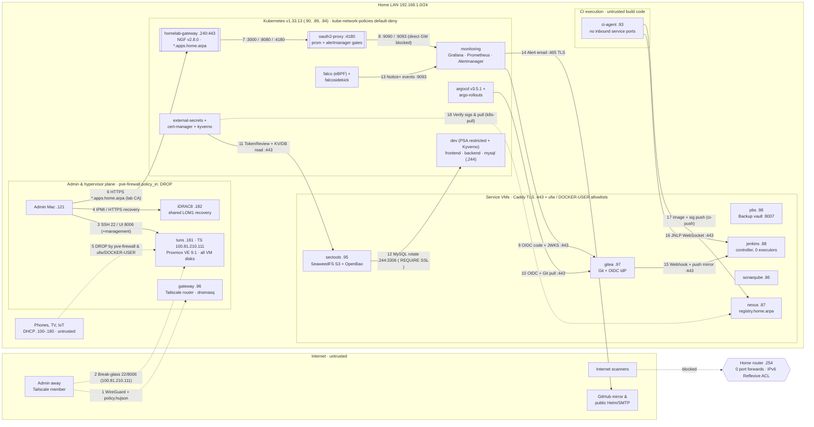
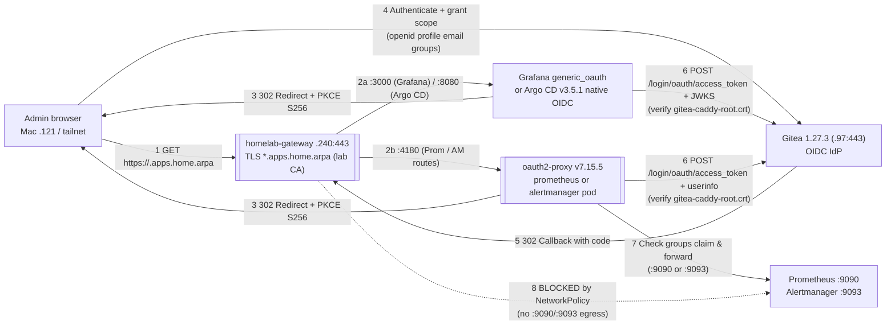
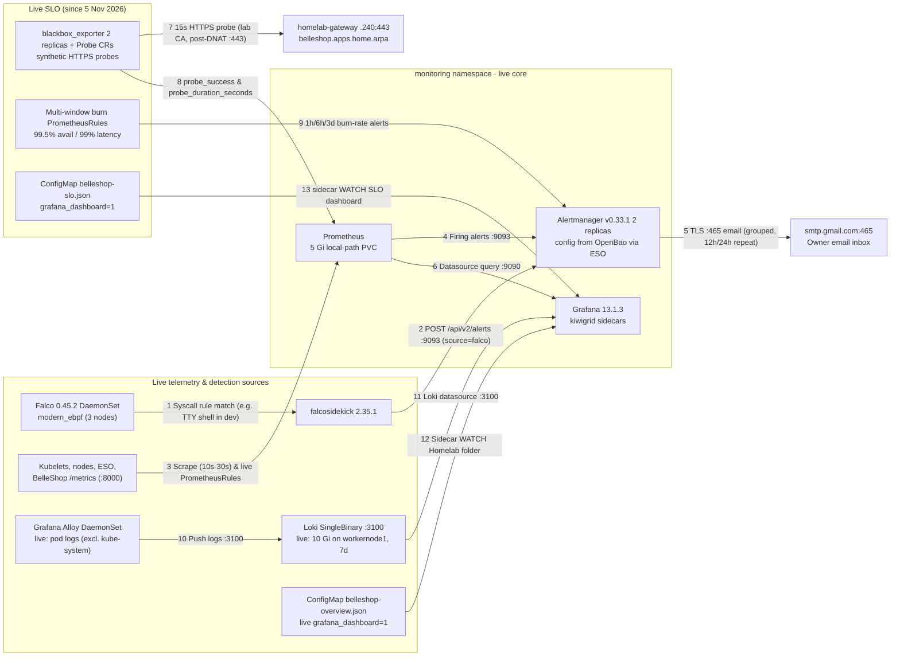

# Architecture (weeks 1–7)

- **Status:** Living
- **Owner:** Platform owner
- **Last reviewed:** 7 Nov 2026 (last reviewed 2026-11-07)
- **Next review:** 14 Nov 2026

The engineering view of the homelab platform as built and verified live on `7 Nov 2026` (`2026-11-07`), with topology last fully inventoried on `4 Nov 2026`: where every component runs, which zones trust which, who logs in where, how code, secrets, and alerts move, and what is still planned or open. Written to [the architecture documentation standard](standards/architecture-docs.md).

- **17 VMs** on one Proxmox VE 9.1 hypervisor (`tuns`, `.181`): **13 running** (11 managed by Terraform), **1 stopped on forensic hold** (`101 UbuntuNew` until `25 Nov 2026`), and **3 stopped templates** (`109`, `110`, `130`); 0 LXC containers (`pct list` empty); retired VMs `100` and `104`–`106` purged `4 Nov 2026`
- **Zero internet-forwarded ports**, Proxmox host firewall (`policy_in: DROP`) restricted to the admin Mac (`.121`) and `tailscale0` (`100.64.0.0/10`) with out-of-band iDRAC8 recovery on shared LOM1 (`.182`), and default-deny Kubernetes `NetworkPolicy` enforcement (`kube-network-policies` `v1.1.2`) across all 8 workload and platform namespaces
- **Single sign-on via Gitea OIDC** for Grafana, Argo CD, and `oauth2-proxy` gates in front of Prometheus and Alertmanager; secrets stored in **OpenBao** (`sectools`) with 24-hour MySQL credential rotation via External Secrets Operator (ESO) and `etcd` `secretbox` encryption at rest
- **6 CI security gates** and **Kyverno** admission enforcement (`ValidatingPolicy` + `ImageValidatingPolicy`) admitting only Cosign-signed, digest-pinned images with signed SPDX SBOM attestations from Nexus into `dev`
- **Runtime eBPF detection** via **Falco** (`modern_ebpf`, Lynis exception PRs `#83`/`#85`) and `falcosidekick` routing to Alertmanager email delivery; **Loki + Grafana Alloy** log collection is **live** (PRs `#58`/`#60`); dashboards as code ship from git; **blackbox_exporter** SLO probes, burn-rate rules, and `belleshop-slo.json` are **live** since `5 Nov 2026` ([ADR 0017](adr/0017-logs-dashboards-belleshop-slos.md); proof [`runbooks/belleshop-slo.md`](runbooks/belleshop-slo.md))

## Revision history

| Rev | Date | Change |
|---|---|---|
| A | 30 Oct 2026 | Initial architecture overview (weeks 1–3): topology, trust boundaries, CI pipeline, supply chain, gaps |
| B | 30 Oct 2026 | Added non-gate CI stage schedules and digest/promotion explanations |
| C | 31 Oct 2026 | Week 4: Kyverno admission enforced in `dev`, GitOps promotion PR loop, Kubernetes `1.33.13` upgrade |
| D | 31 Oct 2026 | Replaced `ingress-nginx` with NGINX Gateway Fabric `v2.8.0` on `.240` ([ADR 0013](adr/0013-gateway-api.md)) |
| E | 4 Nov 2026 | Weeks 5–7: OpenBao + ESO + 24h DB rotation + `etcd` encryption + scoped certs ([ADR 0014](adr/0014-secrets-and-identity.md)); two-tier lab CA + TLS, default-deny NetworkPolicies, Proxmox firewall + iDRAC, legacy `10.2.0.x` NAT & `tuns` `dnsmasq` retired, Falco → Alertmanager email ([ADR 0015](adr/0015-network-policy-and-platform-hardening.md)); Gitea OIDC SSO + `oauth2-proxy` + `homelab-bot` ([ADR 0016](adr/0016-oidc-sso-admin-uis-gitea.md)); Loki/Alloy/SLOs shown as planned ([ADR 0017](adr/0017-logs-dashboards-belleshop-slos.md)); VMs `100` and `104`–`106` deleted |
| F | 4 Nov 2026 | Loki + Grafana Alloy live (PRs `#58`, `#60`); dashboards as code (`belleshop-overview.json`); blackbox/SLO rules/SLO dashboard remain planned ([ADR 0017](adr/0017-logs-dashboards-belleshop-slos.md)) |
| G | 4 Nov 2026 | ADR 0017 PR 3 in git: `blackbox_exporter` 11.20.2, Probe CRs, SLO PrometheusRules, Alertmanager `BelleShop.*` route, `belleshop-slo.json`. (Historical: not yet live on 4 Nov; zero Probe CRs until Argo sync.) |
| I | 7 Nov 2026 | Hardening items closed: kube-network-policies digest pin (`#87`); nightly etcd snapshots 00:45 America/Chicago with PKI + encryption config (`#88`, `#91`) and Level 1 restore drill **PASS** (17 namespaces / 42 Secrets = live; `#92`–`#95`); Lynis managed + hardening index exported via node-exporter textfile collector (`#90`); Rollouts Gateway API plugin served in-lab, `argo-rollouts-plugin-download-egress` removed (`#89`). |
| H | 7 Nov 2026 | Blackbox + BelleShop SLO probes **live** since 5 Nov ([`runbooks/belleshop-slo.md`](runbooks/belleshop-slo.md)); Alertmanager 2 replicas + anti-affinity (`#78`); blackbox 2 replicas (`#79`/`#80`); Watchdog → healthchecks.io (`#81`); PBS fleecing on `daily-all` (`#84`); Falco Lynis exception (`#83`, `#85`). |

## Scope

**In scope:**

- **Context, topology, and trust boundaries:** live hypervisor (`tuns`), VM (`qm list`), and Kubernetes `v1.33.13` deployment schedules, host firewalls, Tailscale ACLs, internal PKI, and namespace `NetworkPolicy` isolation as of `4 Nov 2026` (platform follow-ups through `7 Nov 2026`).
- **Identity, authentication, and secrets:** human authentication paths (Gitea OIDC SSO group mapping, SSH, TOTP, short-lived `kubectl` client certificates) and machine credentials (`homelab-bot`, OpenBao + ESO secret delivery, 24h MySQL password rotation, `etcd` encryption at rest).
- **Data flows and observability:** end-to-end workflows for software delivery (`git` → Jenkins → Nexus → promotion PR → Argo CD → Kyverno), OIDC browser login via Gitea, runtime alerting (Falco/Prometheus → Alertmanager HA → email + Watchdog healthchecks.io), live Loki/Alloy logs, and live blackbox SLO probes ([ADR 0017](adr/0017-logs-dashboards-belleshop-slos.md); proof 5 Nov).

**Out of scope:**

- **Step-by-step operator procedures, break-glass commands, and rollback playbooks:** live in [`docs/runbooks/`](runbooks/) and [`docs/entry-points.md`](entry-points.md).
- **Design option evaluations and incident timelines:** live in [`docs/adr/`](adr/) (`0001`–`0017`) and [`docs/postmortems/`](postmortems/).
- **Application source code and Kubernetes workload manifests for BelleShop:** live in the `BelleShop` and `belleshop-deploy` repositories.

---

## Sheet G-1 · Context and topology

One physical server, **`tuns`** (Dell PowerEdge R730xd, Proxmox VE `9.1.2`, 40 threads, 62 GB RAM, two mirrored 4 TB disks), runs every VM on one flat home network, `192.168.1.0/24`. Out-of-band hardware recovery is provided by **iDRAC8** (firmware `2.86`) on shared LOM1 (`nic0`) at `192.168.1.182` ([ADR 0015](adr/0015-network-policy-and-platform-hardening.md) §C, [`runbooks/idrac-and-firewall.md`](runbooks/idrac-and-firewall.md)).

On VM hosts, services bind `127.0.0.1` and are exposed through Caddy on `:443` behind `ufw` or `DOCKER-USER` allowlists. On the Kubernetes cluster, all HTTP(S) ingress enters through **NGINX Gateway Fabric `v2.8.0`** (`Gateway/homelab-gateway` on MetalLB VIP `192.168.1.240`, `:443` with `:80` → `:443` `RequestRedirect`) using a wildcard leaf certificate for `*.apps.home.arpa` issued by `cert-manager` from the lab's two-tier internal CA ([ADR 0013](adr/0013-gateway-api.md), [ADR 0015](adr/0015-network-policy-and-platform-hardening.md) §B). Internal DNS for `*.home.arpa` and `*.apps.home.arpa` is served by `dnsmasq` on `gateway` (`.96`, [ADR 0004](adr/0004-internal-dns.md)); the stale legacy `dnsmasq` on `tuns` (`10.2.6.181`, `homelab.local`) was stopped and disabled on `3 Nov 2026` (`scripts/pve-dnsmasq-retire.sh`).

### Hypervisor and virtual machine schedule (verified live via `qm list` and `pct list`, `4 Nov 2026`)

| Host / VM name | VMID · IPv4 | Status · Sizing | Role | Provisioned by | Inbound reachability |
|---|---|---|---|---|---|
| `tuns` (`proxmox.home.arpa`) | — · `.181` (Tailscale `100.81.210.111`) | running · 40c / 62 GB / 3.7 TB LVM-thin | Proxmox VE 9.1 hypervisor; root of trust for every VM disk | hand + Ansible (`proxmox-ssh.yml`) | `22` (key only), `8006` (lab-CA TLS + TOTP); `pve-firewall` `policy_in: DROP`, `management` ipset only (`.121`, `100.64.0.0/10`) |
| `tuns` iDRAC8 | — · `.182` | running · shared LOM1 (`nic0`) | Out-of-band hardware power, sensor, and console recovery ([ADR 0015](adr/0015-network-policy-and-platform-hardening.md) §C) | `scripts/idrac-setup.sh` (`ipmitool`) | `443`, `623/udp` (LAN; UI IP-range filter to `.121` pending) |
| `sectools` (`s3`, `bao`) | `120` · `.95` | running · 2c / 4 GB / 60 GB | **SeaweedFS S3** (`s3.home.arpa`, `tfstate` bucket with 30d Object Lock, [ADR 0007](adr/0007-terraform-state-seaweedfs-s3.md)) and **OpenBao `v2.7.2`** (`bao.home.arpa`, Raft storage, swap off, [ADR 0014](adr/0014-secrets-and-identity.md)) | Terraform + Ansible | `22`; `443` (`s3`: `.121`, `.96`; `bao`: `.121`, `.96`, k8s nodes `.90`, `.89`, `.84`; `/v1/sys/generate-root*` & `/v1/sys/rekey*` blocked with `403` by Caddy) |
| `gateway` | `121` · `.96` | running · 1c / 1 GB / 40 GB | Tailscale subnet router (`tag:homelab-gateway`) advertising lab CIDRs; `dnsmasq` for `*.home.arpa` and `*.apps.home.arpa` ([ADR 0002](adr/0002-remote-access-tailscale-subnet-router.md), [ADR 0004](adr/0004-internal-dns.md)) | Terraform + Ansible | `22`, `53/udp+tcp` (LAN + Tailscale split DNS) |
| `gitea` | `122` · `.97` | running · 2c / 2 GB / 40 GB | Gitea `1.27.3`: source of truth for Git repos and **OIDC identity provider** (`https://gitea.home.arpa`, [ADR 0005](adr/0005-gitea-rebuild.md), [ADR 0016](adr/0016-oidc-sso-admin-uis-gitea.md)) | Terraform + Ansible | `22`; `443` (`ufw`: `.121`, `.96`, `.90`, `.89`, `.84`, `.88`, `.93`; Gitea SSH off) |
| `pbs` | `123` · `.98` | running · 2c / 4 GB / 40+500 GB | Proxmox Backup Server 4 (Debian 13), nightly `01:30` backup of all VMs, 7d/4w/3m retention, fleecing on `daily-all` to `local-lvm` ([ADR 0006](adr/0006-backups-proxmox-backup-server.md), `#84`) | Terraform + Ansible | `22`; `8007` (`ufw`: `.181`, `.121`, `.96`; TOTP + append-only token `pve@pbs!tuns`) |
| `nexus` (`registry`) | `124` · `.87` | running · 4c / 6 GB / 40+100 GB | Nexus Repository CE (`nexus.home.arpa`) and OCI registry (`registry.home.arpa`: `belleshop` hosted `allow_once` + `dockerhub` proxy, [ADR 0011](adr/0011-ci-platform-rebuild.md)) | Terraform + Ansible | `22`; `443` (`DOCKER-USER` + `ufw`: `.121`, `.96`, `.93`, `.90`, `.89`, `.84`) |
| `sonarqube` (`sonar`) | `125` · `.86` | running · 2c / 4 GB / 40 GB | SonarQube Community Build `26.10` + local PostgreSQL 16 ([ADR 0011](adr/0011-ci-platform-rebuild.md)) | Terraform + Ansible | `22`; `443` (`DOCKER-USER` + `ufw`: `.121`, `.96`, `.88`, `.93`) |
| `jenkins` | `126` · `.88` | running · 2c / 2 GB / 40 GB | Jenkins LTS controller, JCasC, **0 executors**, holds CI credentials ([ADR 0011](adr/0011-ci-platform-rebuild.md)) | Terraform + Ansible | `22`; `443` (`ufw`: `.121`, `.96`, `.97` webhook, `.93` inbound JNLP WebSocket, `.86`) |
| `ci-agent` | `127` · `.93` | running · 2c / 4 GB / 60 GB | Isolated CI build agent: Docker, Trivy `0.76.1`, Syft, Cosign, Gitleaks `8.30.1`, gates in `/opt/ci-gates` ([ADR 0011](adr/0011-ci-platform-rebuild.md)) | Terraform + Ansible | `22` only (no inbound service ports; dials outbound WebSocket to `jenkins:443`) |
| `MasterNode` (`master`) | `108` · `.90` | running · 2c / 4 GB / 40 GB | Kubernetes `v1.33.13` control plane (`kubeadm`, `etcd` encrypted at rest with `secretbox` + nightly snapshot 00:45 America/Chicago to `/var/backups/etcd`, Flannel `v0.28.9`, pod CIDR `10.244.0.0/24`) | Imported into Terraform ([ADR 0010](adr/0010-adopt-k8s-workers-terraform-import.md)) | `22`, `6443`, `10250` (LAN) |
| `WorkerNode1` (`workernode1`) | `107` · `.89` | running · 2c / 4 GB / 80 GB | Kubernetes `v1.33.13` worker (pod CIDR `10.244.3.0/24`; hosts `mysql-0`, `alertmanager-0`, `grafana`, `oauth2-proxy`, `argocd` controllers, `falcosidekick`, **`loki-0`**) | Imported into Terraform ([ADR 0010](adr/0010-adopt-k8s-workers-terraform-import.md)) | `22`, `10250`, MetalLB L2 VIPs `.240`–`.244` |
| `WorkerNode2` (`workernode2`) | `102` · `.84` | running · 2c / 4 GB / 80 GB | Kubernetes `v1.33.13` worker (pod CIDR `10.244.4.0/24`; hosts `homelab-gateway-nginx`, `prometheus-0`, `alertmanager-1` (`#78`), `argocd-server`, `kyverno`, `cert-manager`, `external-secrets`) | Imported into Terraform ([ADR 0010](adr/0010-adopt-k8s-workers-terraform-import.md)) | `22`, `10250`, MetalLB L2 VIPs `.240`–`.244` |
| `TomCatAppServer`, `DockerApp` | `103` · `.85`, `111` · `.92` | running · 4 GB / 40 GB, 8 GB / 40 GB | Legacy application hosts (DockerApp Actions runner disabled `2026-10-26`) | hand + Ansible | `22`; DockerApp ports restricted to `.121`, `.96` via `DOCKER-USER` |
| `UbuntuNew` | `101` · `.83` | **stopped** · 4 GB / 40 GB | **Forensic hold (`onboot: 0`):** retired Gitea VM from the `25 Oct 2026` incident ([postmortem](postmortems/2026-10-25-gitea-rce-cve-2026-60004.md)); retain until **25 Nov 2026** (`2026-11-25`), then destroy | hand | none (powered off) |
| `Template`, `Template-Hardened`, `debian13-template` | `109`, `110`, `130` | **stopped** · 40 GB, 40 GB, 3 GB | Proxmox cloud-init VM templates (`109` Ubuntu 24.04 for `vm` module; `110` hardened; `130` Debian 13 for `pbs`) | `scripts/build-debian-template.sh` / hand | none (templates) |

> **Retired VMs removed on `4 Nov 2026`:** `100 LocalAI` (`.91`), `104 SonarQuality`, `105 JenkinsCICD`, and `106 Nexus` were destroyed (`qm destroy --purge`, PBS backups kept) on `4 Nov 2026` and no longer exist in `qm list`.

### Kubernetes platform and workload schedule (`v1.33.13`, verified live `4 Nov 2026`)

| Namespace | Component(s) | State | Gateway route / VIP | Default-deny NetPol | Purpose and ADR |
|---|---|---|---|---|---|
| `nginx-gateway` | NGINX Gateway Fabric `v2.8.0` (`nginx-gateway` control plane + `homelab-gateway-nginx` NGINX OSS `1.31.7` data plane) | **Live** | MetalLB `192.168.1.240` (`:80` redirect, `:443` TLS `*.apps.home.arpa`) | Yes (ingress + egress) | Split control/data-plane Gateway API `v1.6.3` entry point ([ADR 0013](adr/0013-gateway-api.md), [ADR 0015](adr/0015-network-policy-and-platform-hardening.md)) |
| `cert-manager` | `cert-manager` `v1.21.3`, `ClusterIssuer/lab-ca`, wildcard `Certificate/apps-home-arpa` | **Live** | internal | Yes (ingress + egress) | Issues and auto-renews 90-day leaf certs from the 5-year lab intermediate CA ([ADR 0015](adr/0015-network-policy-and-platform-hardening.md) §B) |
| `kube-network-policies` | `kube-network-policies` `v1.1.2@sha256:c671f98e…` DaemonSet (3 pods, digest-pinned `#87`) | **Live** | hostNetwork | Exempt (enforcer) | Userspace nftables `NFQUEUE` policy enforcement for Flannel; fail-open default + JSON verdict logs ([ADR 0015](adr/0015-network-policy-and-platform-hardening.md) §A) |
| `external-secrets` | External Secrets Operator (chart `2.14.0`, 3 pods) | **Live** | internal | Yes (ingress + egress) | Syncs secrets from OpenBao (`bao.home.arpa:443`) into `dev` and `monitoring` via Kubernetes `TokenReview` auth ([ADR 0014](adr/0014-secrets-and-identity.md)) |
| `kyverno` | Kyverno admission/background/cleanup/reports controllers + 5 `policies.kyverno.io` policies | **Live** | internal | Yes (ingress + egress) | Enforces Cosign signature + SPDX SBOM attestation (`verify-belleshop-images`), Nexus-only registry, digest pinning, no `:latest`, and non-zero CPU request + memory request + memory limit (no CPU limit required) on namespaces labeled `homelab.arpa/admission: enforced` (`dev`) ([ADR 0012](adr/0012-promotion-and-admission-control.md)) |
| `argocd` | Argo CD `v3.5.1` (`platform-root` app-of-apps + 15 child Applications) | **Live** | `https://argocd.apps.home.arpa` (also legacy LB `.241`) | Yes (ingress + egress) | GitOps continuous delivery and native Gitea OIDC SSO ([ADR 0008](adr/0008-argocd-app-of-apps-platform.md), [ADR 0016](adr/0016-oidc-sso-admin-uis-gitea.md)) |
| `argo-rollouts` | Argo Rollouts controller `v1.9.1` + Gateway API traffic-router plugin `v0.17.0` (initContainer from `registry.home.arpa`, sha256-checked, `file://`; no internet egress since `#89`) + dashboard | **Live** | `https://rollouts.apps.home.arpa` (also legacy LB `.243`) | Yes (ingress + egress) | Progressive canary delivery weighting `HTTPRoute/belleshop-api` against Prometheus success-rate analysis ([ADR 0012](adr/0012-promotion-and-admission-control.md), [ADR 0013](adr/0013-gateway-api.md)) |
| `monitoring` | `kube-prometheus-stack` `88.3.0` (Grafana `13.1.3`, Prometheus, Alertmanager `v0.33.1` **2 replicas** hard anti-affinity `#78`, `kube-state-metrics`, `node-exporter`) + 2 `oauth2-proxy` `v7.15.5` instances (chart `10.7.1`) + **Loki `SingleBinary` 3.7.9** (10 Gi worker PVC, 7d) + **Grafana Alloy** DaemonSet (3/3, excl. `kube-system`) + **`blackbox_exporter`** chart `11.20.2` (`v0.29.1`, **2 replicas** `#79`/`#80`) + 3 `Probe` CRs + SLO rules | **Live** | `https://grafana.apps.home.arpa` (also LB `.242`), `https://prometheus.apps.home.arpa`, `https://alertmanager.apps.home.arpa`; Loki `:3100` in-cluster | Yes (ingress + egress, including `:3100` / Alloy `:12345`) | Metrics, logs, ESO-templated SMTP alerting, Watchdog → healthchecks.io (`#81`), Grafana native OIDC, oauth2-proxy, and live BelleShop SLO probes ([ADR 0015](adr/0015-network-policy-and-platform-hardening.md) §D, [ADR 0016](adr/0016-oidc-sso-admin-uis-gitea.md), [ADR 0017](adr/0017-logs-dashboards-belleshop-slos.md)) |
| `falco` | Falco `0.45.2` (chart `9.2.2`, `modern_ebpf` probe, 3 DaemonSet pods) + `falcosidekick` `2.35.1` | **Live** | internal | Exempt (host eBPF agent) | Kernel eBPF runtime syscall detection forwarding `Notice`+ events to Alertmanager `:9093`; Lynis exception pinned to dash under PID 1 (`#83`, `#85`) ([ADR 0015](adr/0015-network-policy-and-platform-hardening.md) §D) |
| `dev` | BelleShop `frontend` (`nginx:alpine`, 2 pods), `backend` (`python:3.12-slim` Rollout, 2 pods), `mysql-0` (`mysql:8.0.46`, 5 Gi PVC) | **Live** | `https://belleshop.apps.home.arpa` (`/` and `/api`), `https://api-belleshop.apps.home.arpa`; `mysql-bao` LB `.244:3306` (`.95/32` only, no NodePort) | Yes (ingress + egress) | Application namespace under Pod Security `restricted` and Kyverno `enforced`; DB credentials rotated every 24h by OpenBao ([ADR 0012](adr/0012-promotion-and-admission-control.md), [ADR 0014](adr/0014-secrets-and-identity.md), [ADR 0015](adr/0015-network-policy-and-platform-hardening.md)) |
| `kube-system`, `kube-flannel`, `metallb-system`, `local-path-storage` | Control plane (`kube-apiserver`, `etcd`, `controller-manager`, `scheduler`), `coredns`, `metrics-server` ([ADR 0009](adr/0009-metrics-server-verified-kubelet-tls.md)), `kube-flannel-ds` `v0.28.9`, MetalLB `v0.14.8`, `local-path-provisioner` | **Live** | `192.168.1.90:6443` | Exempt (control/CNI/storage) | Cluster substrate; `coredns` forwards `home.arpa:53` to `192.168.1.96` |
| `monitoring` *(ADR 0017 SLO)* | **`blackbox_exporter`** chart `11.20.2` (`v0.29.1`, 2 replicas), 3 `Probe` CRs, `belleshop-slo-rules`, `belleshop-slo.json` | **Live** since 5 Nov 2026 (proof [`runbooks/belleshop-slo.md`](runbooks/belleshop-slo.md); was zero Probe objects on 4 Nov) | Probes target Gateway data-plane pod `:443` (post-DNAT of `.240`) | blackbox → `homelab-gateway-nginx:443`; Prometheus → blackbox `:9115` | 99.5%/30d availability SLO; Watchdog dead-man `#81` ([ADR 0017](adr/0017-logs-dashboards-belleshop-slos.md)) |

---

## Sheet N-1 · Network and trust boundaries

Zones are drawn by how much we trust what runs inside them and what network enforcement stands at each border. Callout numbers on the drawing match the boundary crossing schedule below.

**`Sheet N-1 · Network and trust boundaries · View: security · Rev E · 4 Nov 2026`**

> **Claim (alt text):** Zero ports are forwarded from the internet; remote administration enters only via WireGuard and Tailscale ACLs (`gateway` `.96` for lab subnets or `tuns` `100.81.210.111` for hypervisor break-glass). On the LAN, `tuns` enforces `policy_in: DROP` (accepting `22`/`8006` only from the Mac `.121` and `tailscale0`), VM services enforce Caddy TLS and `ufw`/`DOCKER-USER` allowlists, and the Kubernetes cluster enforces default-deny `NetworkPolicy` isolation across all 8 platform and app namespaces, with all browser UI traffic terminating TLS on `homelab-gateway` (`.240:443`) and authenticating via Gitea OIDC.

### Numbered boundary crossing workflow

| # | Crossing (`src` → `dst`) | Authenticated by | Network & policy enforcement |
|---|---|---|---|
| 1 | Admin (away) → `gateway` (`.96`) → lab LAN | Tailscale identity + WireGuard | [`tailscale/policy.hujson`](../tailscale/policy.hujson) grants `autogroup:member` access only to lab subnets (`.84/30`, `.88/29`, `.96/31`, `.98/32`, `.181/32`, `.240/30`), excluding `.100`–`.180` home/IoT DHCP; `tag:homelab-gateway` cannot initiate connections back to member devices. |
| 2 | Admin (away) → `tuns` (`100.81.210.111`) | Tailscale identity + root SSH key / `root@pam` TOTP | Break-glass direct tailnet node (`tag:homelab-breakglass`, [ADR 0003](adr/0003-break-glass-access.md)): policy allows only `tcp:22` and `tcp:8006`. Required off-LAN because traffic via `gateway` arrives SNATed as `.96`, which is excluded from `tuns`'s `management` ipset ([`runbooks/idrac-and-firewall.md`](runbooks/idrac-and-firewall.md)). |
| 3 | Admin Mac (`.121`) → `tuns` (`.181`) | Root SSH key (`22`); `root@pam` password + TOTP (`8006`) | `pve-firewall` enabled (`policy_in: DROP`, `policy_out: ACCEPT`); `local_network` alias overridden to `.121` and `management` ipset restricted to `192.168.1.121` and `100.64.0.0/10` ([ADR 0015](adr/0015-network-policy-and-platform-hardening.md) §C). |
| 4 | Admin Mac (`.121`) → iDRAC8 (`.182`) | iDRAC `root` password (rotated via stdin `ipmitool exec`) | Shared LOM1 (`nic0`) on `192.168.1.182/24`; provides hardware power/console recovery independent of `pve-firewall`. (Web UI IP-range filter to `.121/32` is a tracked follow-up.) |
| 5 | Home/IoT devices or VMs → `tuns` & service VMs | None | Dropped at `tuns` by `pve-firewall` (proven from `sectools`: `:8006` returns `000` and `:22` times out) and dropped at service VMs by `ufw` and `DOCKER-USER` allowlists ([`entry-points.md`](entry-points.md)). |
| 6 | Browser (`.121` / tailnet) → `homelab-gateway` (`.240:443`) | TLS leaf (`*.apps.home.arpa`, signed by `lab-ca`) + Gitea OIDC session | NGINX Gateway Fabric `v2.8.0` data plane (`homelab-gateway-nginx`, `externalTrafficPolicy: Local`); `:80` redirects to `:443` with `301`/`302`. |
| 7 | `homelab-gateway-nginx` → route backends | In-cluster pod network | `nginx-gateway-data-plane-egress` allows only `dev` (`:3000`, `:8000`), `monitoring` Grafana (`:3000`) and `oauth2-proxy` (`:4180`), `argocd-server` (`:8080`), and `argo-rollouts-dashboard` (`:3100`). Direct egress to Prometheus `:9090` and Alertmanager `:9093` is **removed** ([ADR 0016](adr/0016-oidc-sso-admin-uis-gitea.md)). |
| 8 | `oauth2-proxy` (`:4180`) → Prometheus (`:9090`) / Alertmanager (`:9093`) | Verified Gitea OIDC session cookie (`session-cookie-minimal: true`) | `monitoring-prometheus-ui-ingress` and `monitoring-alertmanager-ui-ingress` only accept UI traffic from their matching `oauth2-proxy` pod selector. Alertmanager requires `homelab:platform-admins`; Prometheus requires `homelab`. |
| 9 | `monitoring` (Grafana & `oauth2-proxy`) → `gitea` (`.97:443`) | OIDC `client_id` + `client_secret` (from OpenBao via ESO) + PKCE `S256` | Allowed by `monitoring-grafana-oidc-egress` and `monitoring-oauth2-proxy-gitea-egress` to `192.168.1.97/32:443`; TLS verified against ConfigMap `gitea-caddy-root`. |
| 10 | `argocd` → `gitea` (`.97:443`) | Read-only repo token (`argocd/gitea-belleshop-readonly`) + OIDC client secret (`argocd-secret`) | Allowed by `argocd-server-egress` and `argocd-repo-server` egress to `192.168.1.97/32:443`; TLS verified via `argocd-tls-certs-cm` and `oidc.config.rootCA`. |
| 11 | `external-secrets` (ESO) → `sectools` OpenBao (`.95:443`) | ServiceAccount JWT verified by OpenBao via Kubernetes `TokenReview` (`system:auth-delegator`) | Allowed by `external-secrets-openbao-egress` to `192.168.1.95/32:443`; `sectools` `ufw` allows `.90`, `.89`, `.84` on `:443`, while Caddy restricts `s3.home.arpa` to `.121`/`.96` so nodes cannot read Terraform state ([ADR 0014](adr/0014-secrets-and-identity.md)). |
| 12 | `sectools` OpenBao (`.95`) → `dev/mysql-0` (`.244:3306`) | MySQL user `bao-admin@'10.244.%'` with `REQUIRE SSL` | `Service/mysql-bao` (`192.168.1.244`) enforces `loadBalancerSourceRanges: [192.168.1.95/32]` and `allocateLoadBalancerNodePorts: false`; `dev-mysql-ingress` allows `:3306` only from `app=backend` pods and the 6 node `flannel.1`/`cni0` masquerade `/32` addresses (`10.244.{0,3,4}.{0,1}/32`). |
| 13 | `falco` (`falcosidekick`) → `monitoring` Alertmanager (`:9093`) | Namespace/pod network policy (`monitoring-alertmanager-falco-ingress`) | `falco` DaemonSet (`modern_ebpf`) emits runtime alerts to `falcosidekick`, which POSTs `Notice`+ events to Alertmanager `/api/v2/alerts` ([ADR 0015](adr/0015-network-policy-and-platform-hardening.md) §D). |
| 14 | `monitoring` Alertmanager → `smtp.gmail.com:465` | Dedicated Gmail app password (`secret/monitoring/alertmanager` via ESO) | Allowed by `monitoring-alertmanager-egress` (`:465` to public IPs excluding RFC 1918 / link-local ranges). |
| 15 | `gitea` (`.97`) → `jenkins` (`.88:443`) & GitHub mirror | Jenkins CA trusted by Gitea; fine-grained GitHub token (`homelab-platform` only) | `jenkins.home.arpa` is the sole webhook target in `ALLOWED_HOST_LIST`; `homelab-platform` push-mirrors outward to GitHub. |
| 16 | `ci-agent` (`.93`) → `jenkins` (`.88:443`) | Inbound JNLP agent secret from `/etc/jenkins-agent/secret` (`0600`) | Outbound WebSocket on `:443` from `ci-agent`; the controller holds no SSH key to `ci-agent` and `ci-agent` listens on no service ports. |
| 17 | `ci-agent` (`.93`) → `nexus` (`.87:443`) & `gitea` (`.97:443`) | `ci-push` (Nexus) and `ci-promote` (Gitea) via stdin | Pushes digest-pinned images, Cosign signatures, and SPDX SBOM attestations to `registry.home.arpa/belleshop`, then opens a promotion PR in `belleshop-deploy`. |
| 18 | `kyverno` & kubelets → `nexus` (`.87:443`) | `k8s-pull` (`dev/nexus-pull`, `kyverno/nexus-pull`, read-only) | Allowed by `kyverno-registry-egress` (`192.168.1.87/32:443`); verifies Cosign signatures and SBOM attestations before admitting pods to `dev`. |

### Host firewall and legacy state retirement (`tuns`)

Enabling `pve-firewall` on `3 Nov 2026` loaded `br_netfilter` (`bridge-nf-call-iptables=1`), which briefly routed bridged `vmbr0` HTTP(S) traffic from unfiltered VMs (the Kubernetes nodes, `firewall=0`) through dormant `10.2.0.2` `DNAT`/`MASQUERADE` rules from the pre-`homelab` era ([postmortem `2026-11-03`](postmortems/2026-11-03-pve-firewall-legacy-nat-outage.md)). Both the live `10.2.x` NAT rules and their two boot-restore hooks (`/etc/iptables.rules` in `/etc/network/interfaces` and `/etc/iptables/rules.v4` in `netfilter-persistent`) were removed by `scripts/pve-legacy-nat-cleanup.sh`, and the stale `dnsmasq` service on `tuns` (`10.2.6.181`, `homelab.local`) was retired and disabled by `scripts/pve-dnsmasq-retire.sh` (verified `inactive`/`disabled` live `4 Nov 2026`).

### Two-tier PKI and certificate architecture ([ADR 0015](adr/0015-network-policy-and-platform-hardening.md) §B)

| Tier / Certificate | Subject / Scope | Lifetime & custody | Consumers |
|---|---|---|---|
| **Tier 1: Lab Root CA** (`lab-root.crt`) | ECDSA P-256, `pathlen:1`, **DNS name constraint `home.arpa`** | 10 years (`2026-11-02` to `2036-10-30`); private key **offline only** in owner storage (`private/ca/`, gitignored); public cert at `ansible/files/ca/lab-root.crt` | Mac System keychain, `scripts/route-smoke.sh`, BelleShop test scripts, `blackbox_exporter` (`http_2xx_lab`, ConfigMap `lab-root-ca`) |
| **Tier 2: Lab Intermediate CA** | ECDSA P-256, `pathlen:0`, DNS name constraint `home.arpa` | 5 years (`2026-11-02` to `2031-11-01`); stored in `cert-manager/lab-ca-intermediate` (`etcd` `secretbox`-encrypted) for `ClusterIssuer/lab-ca` | Signs cluster leaf certificates and the Proxmox UI leaf |
| **Gateway Wildcard Leaf** (`apps-home-arpa-tls`) | `*.apps.home.arpa` | 90 days (auto-renewed at 60d by `cert-manager`) | `Gateway/homelab-gateway` `:443` listener (`belleshop`, `api-belleshop`, `argocd`, `grafana`, `rollouts`, `prometheus`, `alertmanager`) |
| **Proxmox UI Leaf** (`pveproxy-ssl.pem`) | `CN=proxmox.home.arpa`, SANs `DNS:proxmox.home.arpa`, `DNS:tuns.home.arpa`, `IP:192.168.1.181` | 825 days (macOS limit; renew by `2 Nov 2028`); key generated on `tuns` and never leaves `tuns`, signed by lab intermediate ([`runbooks/proxmox-ui-cert.md`](runbooks/proxmox-ui-cert.md)) | `https://proxmox.home.arpa:8006` |
| **Per-VM Caddy Roots (5)** | `gitea`, `sectools`, `nexus`, `sonarqube`, `jenkins` (`*.home.arpa`) | 10 years (Caddy local authority); private keys on each VM, public certs in `ansible/files/ca/*-caddy-root.crt` | Distributed to VMs by `lab_ca_trust`, mounted into ESO (`sectools-caddy-root.crt`) and OIDC consumers (`gitea-caddy-root.crt`); re-rooting under `lab-ca` deferred per [ADR 0015](adr/0015-network-policy-and-platform-hardening.md) decision 5 |

---

## Sheet S-1 · Identity, authentication, and secrets

### Human login and authorization matrix ([ADR 0014](adr/0014-secrets-and-identity.md), [ADR 0016](adr/0016-oidc-sso-admin-uis-gitea.md))

Gitea (`1.27.3` on `https://gitea.home.arpa`) is the single OIDC identity provider for browser UIs, using RS256 ID tokens, PKCE (`S256`), and the `groups` claim (which emits `"<org>"` and lowercased `"<org>:<team>"` strings). Each UI consumer uses a dedicated confidential OAuth2 application in Gitea so secrets and revocation remain isolated.

| System / Entry point | Primary authentication | Group / role authorization mapping | Break-glass / fallback path |
|---|---|---|---|
| **Grafana** (`https://grafana.apps.home.arpa`) | Gitea OIDC (`generic_oauth`, PKCE `S256`) | `homelab:platform-admins` → `Admin` `homelab` (org only) → `Viewer` No org → **Denied** (`allowed_groups`) | Local admin login on the same page (`monitoring/grafana-admin` Secret, out of git) |
| **Argo CD `v3.5.1`** (`https://argocd.apps.home.arpa`) | Gitea OIDC (native `argocd-cm` `oidc.config`, PKCE `S256`, Dex bypassed) | `homelab:platform-admins` → `role:admin` `homelab` (org only) → `role:readonly` No org → **Denied** (`policy.default: ""` in `argocd-rbac-cm`) | Local `admin` account (`admin.enabled: "true"`, hash in `argocd-secret` `admin.password`) |
| **Prometheus UI** (`https://prometheus.apps.home.arpa`) | `oauth2-proxy-prometheus` (`v7.15.5`, PKCE `S256`) | `homelab` (includes `homelab:platform-admins`) → **Allowed** No org → **Denied** (`--allowed-group=homelab`) | Admin SSH port-forward (`ssh Master 'sudo kubectl ... port-forward'`) onto `:9090` |
| **Alertmanager UI** (`https://alertmanager.apps.home.arpa`) | `oauth2-proxy-alertmanager` (`v7.15.5`, PKCE `S256`) | `homelab:platform-admins` → **Allowed** `homelab` (org only) or no org → **Denied (`403`)** (`--allowed-group=homelab:platform-admins`, because UI can create silences) | Admin SSH port-forward onto `:9093` |
| **Kubernetes API** (`192.168.1.90:6443`) | 8-hour client certificate (`scripts/k8s-issue-access-cert.sh` via CSR API) | Groups `belleshop-operators` (`Role/belleshop-operator` in `dev`: pods, logs, `pods/exec`, rollout `patch`; **no Secret read**) + `platform-viewers` (`ClusterRole/platform-viewer`: cluster status, no Secrets) | `ssh Master` (`tunsadmin@192.168.1.90`) + `sudo kubectl --kubeconfig /etc/kubernetes/admin.conf` (no admin kubeconfig on Mac since `2 Nov 2026`, [`runbooks/cluster-access.md`](runbooks/cluster-access.md)) |
| **Proxmox VE (`tuns`)** (`.181` / `100.81.210.111`) | SSH (`22`): key-only `root` Web UI (`8006`): `root@pam` + TOTP | Full hypervisor admin (`pve-firewall` restricts source to `.121` and `100.64.0.0/10`) | Tailscale `tag:homelab-breakglass` (`100.81.210.111:22`/`8006`) or hardware iDRAC8 (`192.168.1.182`) |
| **Managed VMs (`120`–`127`, `102`, `107`, `108`)** | SSH (`22`): key-only `tunsadmin` (`PermitRootLogin no`, `AllowUsers tunsadmin`) | Host administration via Ansible | Proxmox VM console via `tuns:8006` |

### Machine identities and secrets schedule (summary of [`credentials.md`](credentials.md))

No secret values live in git. Standing secrets reside in **OpenBao `v2.7.2`** on `sectools` (`127.0.0.1:8200` behind Caddy `https://bao.home.arpa`, Raft storage, 3 unseal shares / threshold 2, swap disabled, HMAC audit log at `/var/log/openbao/audit.log`). The initial OpenBao root token was revoked on `2 Nov 2026`; privileged OpenBao setup runs on `sectools` via `scripts/openbao-breakglass.sh root-run`, which mints a short-lived root token over loopback, executes the setup, and immediately revokes and verifies revocation ([`runbooks/openbao.md`](runbooks/openbao.md)). All Kubernetes Secrets in `etcd` are encrypted at rest with `secretbox` (`XSalsa20-Poly1305`, `--encryption-provider-config-automatic-reload=true`; 34/34 Secrets rewritten and `etcd` defragged to 0 plaintext revisions on `2 Nov 2026`, [`runbooks/etcd-encryption.md`](runbooks/etcd-encryption.md)).

| Credential / Identity | Scope (blast radius) | Stored in / Delivered by | Rotation & custody |
|---|---|---|---|
| **Gitea `homelab-bot` (`agent-pushes`)** | Write collaborator on `homelab-platform`, `belleshop-deploy`, `BelleShop` only (no admin/org scopes); separates agent/Claude git pushes and PRs from owner's `tunsgit` account | Mac `.envrc` as `GITEA_BOT_TOKEN` (`0600`, gitignored) | Created `4 Nov 2026`; supersedes laptop `GITEA_TOKEN` ([`credentials.md`](credentials.md)) |
| **BelleShop MySQL app password** (`belleshop` user) | DML on `belleshop` schema only | OpenBao `database/static-roles/belleshop` → ESO `SecretStore/openbao` → `dev/belleshop-db-eso` → volume file read per connection | **Automated every 24h** via `ALTER USER ... RETAIN CURRENT PASSWORD` over `mysql-bao` (`.244:3306`) with zero pod restarts ([ADR 0014](adr/0014-secrets-and-identity.md)) |
| **OpenBao MySQL root rotator** (`bao-admin@'10.244.%'`) | `CREATE USER` + `REQUIRE SSL` to rotate `belleshop` password (cannot modify `root`, which holds `SYSTEM_USER`) | OpenBao `database/config/mysql` (rotated via `rotate-root` on setup; known only to OpenBao) | Re-run `scripts/openbao-setup-mysql-rotation.sh` |
| **OIDC client & cookie secrets** (`grafana`, `oauth2-proxy-prometheus`, `oauth2-proxy-alertmanager`, `argocd`) | Exchange OAuth2 code at Gitea for that single consumer; sign `oauth2-proxy` cookies (32-byte URL-safe base64) | OpenBao `secret/data/oidc/<consumer>` → ESO `SecretStore/openbao-oidc` (`monitoring/eso-oidc`, policy `oidc-read`), except `argocd` patched into `argocd/argocd-secret` by `scripts/argocd-oidc-apply.sh` | Created `4 Nov 2026` via `scripts/openbao-breakglass.sh root-run oidc <consumer>` ([ADR 0016](adr/0016-oidc-sso-admin-uis-gitea.md)) |
| **Alertmanager SMTP credentials** | Send alert emails via `smtp.gmail.com:465` (dedicated Gmail app password + sender/recipient addresses) | OpenBao `secret/data/monitoring/alertmanager` → ESO `SecretStore/openbao` (`monitoring/eso-alertmanager`, policy `alertmanager-read`) → `monitoring/alertmanager-config-eso` | `scripts/openbao-breakglass.sh root-run alertmanager` ([ADR 0015](adr/0015-network-policy-and-platform-hardening.md) §D) |
| **Alertmanager `watchdog_url`** | Healthchecks.io ping URL for Watchdog (dead-man's switch). Never in git | Same OpenBao path, property `watchdog_url` only | `scripts/openbao-breakglass.sh root-run watchdog-url` ([ADR 0018](adr/0018-week8-chaos-drills.md) follow-up) |
| **Terraform Proxmox token** (`terraform@pve!homelab`) & **S3 key** (`terraform`) | Manage VMs in pool `terraform` only; read/write `s3.home.arpa/tfstate` (30d Object Lock GOVERNANCE prevents version deletion) | Mac `.envrc` and `~/.aws/credentials` (`0600`) | Yearly or on suspected leak ([ADR 0001](adr/0001-terraform-proxmox-greenfield-first.md), [ADR 0007](adr/0007-terraform-state-seaweedfs-s3.md)) |
| **CI credentials** (`ci-push`, `ci-promote`, Sonar `jenkins`, Gitea `jenkins`, Cosign key) | Push images to `registry.home.arpa/belleshop` (`allow_once`); open PRs in `belleshop-deploy`; scan `belleshop`; sign image digests | Jenkins controller credentials store (fed to `ci-agent` via stdin/files, never argv) | Move signing key and remaining static secrets to OpenBao in a later iteration |
| **Nexus `k8s-pull`** & **Argo CD `argocd-readonly`** | Pull images/signatures from Nexus (`403` on push); read Gitea repositories | Kubernetes Secrets `dev/nexus-pull`, `kyverno/nexus-pull`, `argocd/gitea-belleshop-readonly` (`etcd` encrypted) | Hand-created; see open observation on Argo CD repo auth in Sheet Q-1 |
| **PBS backup token** (`pve@pbs!tuns`) | `Datastore.Backup` on `pbs` (`.98`): add backups, **cannot delete or prune** | `tuns` `/etc/pve/priv/storage.cfg` (`0600`) | Yearly ([ADR 0006](adr/0006-backups-proxmox-backup-server.md)) |

---

## Sheet D-1 · Data flows: software delivery, OIDC login, and runtime alerting

### 1. Software delivery and supply-chain flow (`git` → CI gates → Nexus → promotion PR → Argo CD → Kyverno)

Every BelleShop push or pull request triggers a Jenkins multibranch pipeline ([ADR 0011](adr/0011-ci-platform-rebuild.md), [ADR 0012](adr/0012-promotion-and-admission-control.md)). Jenkins (`126`) orchestrates with 0 executors; `ci-agent` (`127`) executes each gate script from [`ci/gates/`](../ci/gates/) (`/opt/ci-gates`). Double-bordered nodes (`[[...]]`) are hard security gates.

**`Sheet D-1a · Software delivery and admission pipeline · View: supply-chain · Rev E · 4 Nov 2026`**

> **Claim (alt text):** Code pushed to Gitea must pass four pre-build gates (Gitleaks, pytest, SonarQube quality gate, Trivy filesystem scan) and an image vulnerability gate (Trivy image scan) on `ci-agent` before `main` builds are pushed by immutable tag to Nexus, signed with Cosign alongside an SPDX SBOM attestation, and proposed via a `ci-promote` PR in `belleshop-deploy`; once merged by the owner, Argo CD syncs the digest-pinned manifest and Kyverno verifies the Cosign signature and SBOM attestation from Nexus before Kubernetes admits the pod into `dev`.

```mermaid
flowchart LR
  devpush["Developer / homelab-bot"] -- "1 git push / PR" --> gitea["Gitea .97"]
  gitea -- "2 Webhook :443" --> jk["Jenkins .88<br/>PR-n or main"]
  jk -- "3 Dispatch over JNLP" --> co["ci-agent .93<br/>IMAGE_TAG = short SHA"]
  co --> sec[["4 Gate: Gitleaks 8.30.1"]]
  sec --> test[["5 Gate: pytest"]]
  test --> sast[["6 Gate: SonarQube 26.10"]]
  sast --> deps[["7 Gate: Trivy 0.76.1 fs"]]
  deps --> build["8 Docker build<br/>base pinned by sha256"]
  build --> img[["9 Gate: Trivy 0.76.1 image"]]
  img --> sbom["10 Syft SPDX SBOM"]
  sbom -- "PR branch" --> stop(["PR stops: nothing pushed"])
  sbom -- "main only: 11 Push (ci-push)" --> nexus["Nexus .87<br/>registry.home.arpa"]
  nexus --> sign["12 Cosign sign +<br/>SBOM attest (by digest)"]
  sign -- "13 Open PR (ci-promote)" --> deployrepo["Gitea: belleshop-deploy"]
  deployrepo -- "14 Owner merge + Argo poll" --> argo["Argo CD v3.5.1"]
  argo -- "15 Apply Rollout" --> kyv[["16 Gate: Kyverno + PSA restricted<br/>verify sig & SBOM against Nexus"]]
  kyv -- "17 Canary 20->50->100<br/>via NGF HTTPRoute + Prom analysis" --> devns["dev namespace<br/>BelleShop live"]
```

#### Numbered delivery workflow

1. **Commit or PR (`1`–`3`):** A developer or `homelab-bot` pushes a branch or opens a PR in Gitea (`.97`), which fires a webhook to `jenkins.home.arpa` (`.88`). Jenkins dispatches the job over the inbound JNLP WebSocket to `ci-agent` (`.93`), setting `IMAGE_TAG` to `git rev-parse --short=12 HEAD` (a branch with an open PR is built once as `PR-n` so concurrent runs do not race in SonarQube Community Build; fork PRs are ignored).
2. **Pre-build security gates (`4`–`7`):** `ci-agent` runs **Gitleaks `8.30.1`** across git history (`.gitleaks.toml`), **pytest** unit tests, **SonarQube `26.10`** SAST (`sonar.qualitygate.wait=true`), and **Trivy `0.76.1` `fs`** for fixable `HIGH`/`CRITICAL` dependency CVEs and Dockerfile/Kubernetes misconfigurations (`.trivyignore.yaml` entries require a `statement` and an expiry $\le 90$ days).
3. **Hermetic-base build, image gate, and SBOM (`8`–`10`):** Docker builds the image from a digest-pinned base (`FROM python:3.12-slim@sha256:aa94…`, with `pip` and `curl` stripped from runtime images). **Trivy `0.76.1` `image`** scans OS and language packages for fixable `HIGH`/`CRITICAL` CVEs ([proof: Week 3 blocked PR-3 with 92 CVEs](evidence/week-03-image-gate-blocked.png)). **Syft** generates an ISO/IEC 5962 SPDX JSON SBOM. PR builds stop here and archive reports.
4. **Publish, sign, and promote (`11`–`13`, `main` only):** `ci-agent` pushes the image to `registry.home.arpa/belleshop` (`allow_once` immutable tags) as `ci-push`, resolves the exact Nexus repository `sha256` digest (not `RepoDigests[0]`), signs the digest and attaches a signed SPDX SBOM attestation with **Cosign 3.x** (`signing-config create --with-default-services=false`: no Rekor/TSA; `ci/gates/sign.sh`), and opens a PR in `belleshop-deploy` as `ci-promote` (`kustomize edit set image`).
5. **GitOps sync, admission verification, and canary rollout (`14`–`17`):** After the owner merges the promotion PR, **Argo CD** syncs `belleshop-deploy`. At admission into `dev`, Kubernetes enforces **Pod Security `restricted`** and **Kyverno** (`ValidatingPolicy` + `ImageValidatingPolicy/verify-belleshop-images`, [proof: Week 4 admission](evidence/week-04-admission.txt)) verifies the Cosign signature and SBOM attestation against `registry.home.arpa` using `cosign.pub`, requires a `@sha256:` digest, blocks `:latest`, and requires non-zero CPU request, memory request, and memory limit (`require-requests-limits` does **not** require a CPU limit). **Argo Rollouts** (`rollouts-plugin-trafficrouter-gatewayapi` `v0.17.0`) steps `HTTPRoute/belleshop-api` canary weights while querying Prometheus (`:9090`) for success-rate analysis.

---

### 2. Browser OIDC single sign-on flow via Gitea ([ADR 0016](adr/0016-oidc-sso-admin-uis-gitea.md))

All four admin UIs (`grafana`, `argocd`, `prometheus`, `alertmanager`) share `homelab-gateway` (`192.168.1.240:443`) and authenticate browsers against Gitea (`192.168.1.97:443`).

**`Sheet D-1b · Browser OIDC login flow · View: dynamic · Rev E · 4 Nov 2026`**

> **Claim (alt text):** Unauthenticated HTTPS requests to any `*.apps.home.arpa` admin UI at `homelab-gateway` (`.240:443`) are redirected with PKCE (`S256`) to `gitea.home.arpa` (`.97:443`); after login, the consumer exchanges the authorization code over TLS verified against `gitea-caddy-root.crt` using client secrets fetched from OpenBao via ESO, evaluates the `groups` claim (`homelab:platform-admins` vs `homelab`), and—for Prometheus and Alertmanager—proxies traffic through `oauth2-proxy` (`:4180`) while direct Gateway access to `:9090`/`:9093` is blocked by NetworkPolicy.

#### Numbered OIDC login workflow

1. **Initial request (`1`–`2`):** Your browser connects to `https://{grafana,argocd,prometheus,alertmanager}.apps.home.arpa` on `192.168.1.240:443` (TLS terminated by `homelab-gateway-nginx` with the `cert-manager` wildcard certificate). `HTTPRoute` forwards Grafana (`:3000`) and Argo CD (`:8080`) directly to their native OIDC handlers (`2a`), and forwards Prometheus and Alertmanager to their dedicated `oauth2-proxy` deployments on `:4180` (`2b`).
2. **OIDC redirect with PKCE (`3`–`5`):** Seeing no valid session cookie, the consumer responds `302` to `https://gitea.home.arpa/login/oauth/authorize` with its consumer-specific `client_id`, exact `redirect_uri`, `scope=openid profile email groups`, and a PKCE `S256` challenge (`3`). You authenticate at Gitea (`4`), which redirects back to the consumer's callback URL on `*.apps.home.arpa` (`5`).
3. **Back-channel token exchange (`6`):** The consumer pod connects directly to `192.168.1.97:443` (permitted by `monitoring-grafana-oidc-egress`, `monitoring-oauth2-proxy-gitea-egress`, and `argocd-server-egress`), verifying Gitea's TLS certificate against `gitea-caddy-root.crt` (mounted ConfigMap in `monitoring`, inline `oidc.config.rootCA` PEM in `argocd-cm`), and exchanges the authorization code + PKCE verifier for an ID token and `groups` claim.
4. **Group authorization and upstream gate (`7`–`8`):** Grafana maps `homelab:platform-admins` to `Admin` and `homelab` to `Viewer`; Argo CD maps them to `role:admin` and `role:readonly` (`policy.default: ""`); `oauth2-proxy` sets a minimal encrypted session cookie (`session-cookie-minimal: true` to stay within NGINX proxy buffer limits) and proxies allowed requests to Prometheus (`:9090`, group `homelab`) or Alertmanager (`:9093`, group `homelab:platform-admins` only) (`7`). Any attempt to reach `:9090` or `:9093` directly from the Gateway pod is dropped by `kube-network-policies` (`8`).

---

### 3. Runtime detection, metrics, logs, and alerting flow (Live [ADR 0015](adr/0015-network-policy-and-platform-hardening.md) + live Loki/SLOs [ADR 0017](adr/0017-logs-dashboards-belleshop-slos.md))

Solid lines (`-->`) show **live** telemetry and alerting paths verified on `7 Nov 2026` (SLO probes live since 5 Nov).

**`Sheet D-1c · Runtime detection, observability, and alerting flow · View: dynamic · Rev H · 7 Nov 2026`**

> **Claim (alt text):** Live today, Falco `modern_ebpf` agents on all 3 nodes detect container anomalies and forward `Notice`+ events via `falcosidekick` to Alertmanager (`:9093`, 2 replicas); Prometheus scrapes cluster, node, ESO, and BelleShop metrics; Grafana Alloy DaemonSets (3/3) ship pod logs excluding `kube-system` to Loki `SingleBinary` on `workernode1` (`:3100`, 10 Gi PVC); Grafana loads git ConfigMaps labelled `grafana_dashboard=1`. Live since 5 Nov: `blackbox_exporter` (2 replicas) probes through the Gateway data-plane pod `:443`, multi-window SLO burn-rate alerts, `belleshop-slo.json`, and Watchdog → healthchecks.io.

#### Numbered observability and alerting workflow

1. **Live runtime syscall detection (`1`–`2`):** **Falco `0.45.2`** runs on all 3 nodes with the embedded `modern_ebpf` probe (`leastPrivileged: true`) and bundled rules (`falcoctl` runtime downloads disabled so pod startup never depends on `ghcr.io` rate limits, [`runbooks/falco-alerts.md`](runbooks/falco-alerts.md)). Known platform controller namespaces are exempted from `Contact K8S API Server From Container`; any interactive shell (`proc.tty != 0`) or unexpected API contact in `dev` emits a `Notice`+ event to **`falcosidekick`** (`1`), which forwards it to **Alertmanager `:9093`** (`monitoring-alertmanager-falco-ingress`) with label `source="falco"` (`2`).
2. **Live metric scraping and rule evaluation (`3`–`4`):** **Prometheus** scrapes kubelets (`:10250`), `node-exporter` (`:9100`), `kube-state-metrics`, CoreDNS, ESO (`:8080`), and BelleShop backend pods (`:8000/metrics` every `10s`), evaluates built-in and custom `PrometheusRule`s (such as `BelleShopDbEsoSyncFailed` and `KubeNetworkPoliciesAgentUnavailable`, with noisy `KubeClientCertificateExpiration` disabled), and sends firing alerts to Alertmanager (`4`).
3. **Live email delivery (`5`–`6`):** **Alertmanager `v0.33.1`** loads `alertmanager-config-eso` (templated by ESO from `secret/data/monitoring/alertmanager` in OpenBao) and delivers notifications over **`smtp.gmail.com:465`** (`5`). To prevent alert floods, the `source="falco"` child route groups by `[rule, k8s_ns_name]` with `repeat_interval: 24h`, and the root route uses `repeat_interval: 12h`. Grafana queries Prometheus on `:9090` (`6`).
4. **Live logs and dashboards (`10`–`12`, [ADR 0017](adr/0017-logs-dashboards-belleshop-slos.md) PRs `#58`/`#60`):** **Grafana Alloy** DaemonSet pods (3/3, including the control-plane taint) collect pod logs via the Kubernetes API for every namespace except `kube-system` and push to **Loki `SingleBinary`** (`:3100`, 10 Gi `local-path` PVC on `workernode1`, 7-day retention) (`10`–`11`). Dashboard JSON under `k8s/platform/monitoring/dashboards/` (`belleshop-overview.json`, `belleshop-slo.json`) ships as ConfigMaps labeled `grafana_dashboard: "1"` into Grafana folder `Homelab`, watched by `kiwigrid/k8s-sidecar:2.10.1` (`12`).
5. **Live synthetic SLOs (`7`–`9`, `13`, since 5 Nov 2026):** `blackbox_exporter` `v0.29.1` (2 replicas) and three `Probe` CRs (`shop-home` on `https://belleshop.apps.home.arpa/`, `shop-api` on `https://belleshop.apps.home.arpa/api/healthz`, debug `api-belleshop.apps.home.arpa/healthz`) probe every `15s` with module `http_2xx_lab` (lab root CA, no redirects). Egress is to the Gateway **pod** `:443` because kube-network-policies evaluates post-DNAT (`7`–`8`). Hand-written multi-window multi-burn-rate `PrometheusRule`s (`1h`/`5m` 14.4× and `6h`/`30m` 6× page; `3d`/`6h` 1× warning; Alertmanager route `alertname=~"BelleShop.*"` grouped by `[alertname, slo, window]`, `repeat_interval: 12h`) enforce a **99.5% 30-day availability SLO**; **99% latency** (`<500ms` home, `<300ms` API) is `severity: warning` until 24h of samples (`9`). Watchdog always-firing alert pings healthchecks.io (`#81`; URL in OpenBao only). Proof: [`runbooks/belleshop-slo.md`](runbooks/belleshop-slo.md).

---

## Sheet Q-1 · Considerations, architecture decisions, and open gaps

### Well-Architected considerations schedule

| Pillar | Today (verified live `7 Nov 2026`) | Largest risk | Next step |
|---|---|---|---|
| **Reliability** | Nightly PBS backups of all VMs (`01:30`, fleecing on `daily-all` `#84`, 6-minute Gitea restore drill passed); Terraform state in SeaweedFS S3 with 30-day Object Lock; Argo CD self-heal + Argo Rollouts canary analysis; Alertmanager 2 replicas (`#78`); Watchdog → healthchecks.io (`#81`); nightly etcd snapshots on `Master` (`/var/backups/etcd`, 7 days, Level 1 restore drill PASS 7 Nov); OpenBao Raft snapshots; iDRAC8 on `.182` + Tailscale break-glass on `tuns` (`100.81.210.111`). | Single physical host (`tuns`) where PBS backups reside on the same mirrored ZFS/LVM array; `local-path` PVCs tie MySQL, Loki, and Prometheus to specific worker nodes; OpenBao requires manual unseal (2 of 3 shares) after a `sectools` reboot; `etcd` full control-plane restore (Level 2) not drilled yet (Level 1 snapshot restore PASS 7 Nov). | `etcd` Level 2 restore drill; add off-host PBS stage 2 target; full-backup fleecing test after a QEMU restart. |
| **Security** | Zero internet port forwards; `pve-firewall` `policy_in: DROP` (`management` ipset `.121` + `tailscale0`); default-deny `NetworkPolicy` across all 8 app/platform namespaces; 2-tier name-constrained lab CA (`home.arpa`); Gitea OIDC SSO + `oauth2-proxy`; 6 CI gates + Cosign + Kyverno admission; OpenBao + ESO 24h MySQL rotation; `etcd` `secretbox` encryption at rest; Falco `modern_ebpf` alerts. | `kube-network-policies` `v1.1.2` runs `--fail-open=true` (mitigated by `KubeNetworkPoliciesAgentUnavailable` alert); Kubernetes node VMs (`108`, `107`, `102`) still have `firewall=0` on their Proxmox NICs and sit on the flat `192.168.1.0/24` LAN; pre-encryption PBS backups retain plaintext Secrets until 3-month retention expires. | Set iDRAC IP-range filter to `.121/32`; evaluate Gitea instance-wide 2FA (`TWO_FACTOR_AUTH=enforced`) after testing CI token compatibility; enable TLS verification on `mysql-bao` (`.244`) and migrate the 5 VM Caddy roots to `lab-ca`. |
| **Operational excellence** | Infrastructure in Terraform (`11` VMs), OS/services in Ansible, cluster platform in Argo CD app-of-apps, CI gates in versioned `/opt/ci-gates` scripts, owner actions codified in `--dry-run` / `--rollback` scripts (`openbao-breakglass.sh`, `argocd-oidc-apply.sh`, `pve-firewall-stage.sh`) with runbooks and blameless postmortems. Loki/Alloy live; dashboards as ConfigMaps under `k8s/platform/monitoring/dashboards/`; blackbox SLO probes live since 5 Nov. | Argo CD's own install manifests and `argocd-cm`/`argocd-rbac-cm` live outside git ([ADR 0008](adr/0008-argocd-app-of-apps-platform.md), mitigated by `scripts/argocd-oidc-apply.sh`); existing `golden-signals` dashboard in `belleshop-deploy` uses unscoped PromQL (`http_requests_total` without `job="backend"`). | Narrow `golden-signals` PromQL in `belleshop-deploy`; keep Argo CD Gitea repo credentials on `homelab-bot` `argocd-read`. |
| **Performance** | Split-plane NGINX Gateway Fabric `v2.8.0` uses ~100–140 MiB RAM across the 2 × 4 GB workers; worker disks grown online from 40 GB to 80 GB (~35–41% used); Falco runs CO-RE `modern_ebpf` with bundled rules (`falcoctl` disabled); Loki `256Mi`/`512Mi` on `workernode1`, Alloy `64Mi`/`128Mi` per node; blackbox 2 replicas. | Worker memory limits remain tight with Loki+Alloy live. Master root disk (`40 GB`) has `16 GB` free (58% used). | Confirm worker `df` after the Loki PVC (owner, [`runbooks/logs.md`](runbooks/logs.md)). |
| **Cost** | Zero cloud compute, managed Kubernetes, or SaaS IdP spend; runs entirely on one existing server (`tuns`) using open-source MPL/Apache components (Proxmox, OpenBao, SeaweedFS, Gitea, NGF, Kyverno, Falco, Prometheus/Grafana/Loki). | Hardware failure of `tuns` or a dual disk failure requires physical replacement parts and off-host backup media. | Add an inexpensive off-host secondary storage target for PBS stage 2 ([ADR 0006](adr/0006-backups-proxmox-backup-server.md)). |

### Architecture decision schedule (`docs/adr/`)

| ADR | Status · Date | Summary |
|---|---|---|
| [ADR 0001](adr/0001-terraform-proxmox-greenfield-first.md) | Accepted · 23 Oct 2026 | Manage Proxmox VMs with `bpg/proxmox` Terraform provider using least-privilege token `terraform@pve!homelab`, starting greenfield |
| [ADR 0002](adr/0002-remote-access-tailscale-subnet-router.md) | Accepted · 24 Oct 2026 | Provide remote LAN access via a dedicated `gateway` VM (`121`, `.96`) running a tagged Tailscale subnet router governed by `tailscale/policy.hujson` |
| [ADR 0003](adr/0003-break-glass-access.md) | Accepted · 24 Oct 2026 | Enrol `tuns` on Tailscale (`tag:homelab-breakglass`, `100.81.210.111`) with no advertised routes and ACL access restricted to `tcp:22` and `tcp:8006` |
| [ADR 0004](adr/0004-internal-dns.md) | Accepted · 24 Oct 2026 | Serve `*.home.arpa` and `*.apps.home.arpa` from `dnsmasq` on `gateway` (`.96`) from a single `dns.yml` inventory list |
| [ADR 0005](adr/0005-gitea-rebuild.md) | Accepted · 25 Oct 2026 | Rebuild Gitea on a dedicated Terraform VM (`122`, `.97`) behind Caddy TLS and `ufw` allowlists after the `UbuntuNew` incident |
| [ADR 0006](adr/0006-backups-proxmox-backup-server.md) | Accepted · 26 Oct 2026 | Run Proxmox Backup Server 4 on VM `123` (`.98`) with nightly backups of all VMs and an append-only `pve@pbs!tuns` token |
| [ADR 0007](adr/0007-terraform-state-seaweedfs-s3.md) | Accepted · 26 Oct 2026 | Store Terraform state on `sectools` (`.95`) in SeaweedFS S3 with native locking, versioning, and 30-day Object Lock (`GOVERNANCE`) |
| [ADR 0008](adr/0008-argocd-app-of-apps-platform.md) | Accepted · 27 Oct 2026 | Manage cluster platform add-ons through an Argo CD `platform-root` app-of-apps in `homelab-platform` while keeping Argo CD itself out of git |
| [ADR 0009](adr/0009-metrics-server-verified-kubelet-tls.md) | Accepted · 27 Oct 2026 | Run `metrics-server` with CA-signed kubelet serving certificates on all nodes instead of `--kubelet-insecure-tls` |
| [ADR 0010](adr/0010-adopt-k8s-workers-terraform-import.md) | Accepted · 27 Oct 2026 | Import the three hand-built Kubernetes node VMs (`108`, `107`, `102`) into Terraform (`k8s_nodes.tf`) with `prevent_destroy` and grow worker disks to 80 GB |
| [ADR 0011](adr/0011-ci-platform-rebuild.md) | Accepted · 28 Oct 2026 | Rebuild Nexus (`124`), SonarQube (`125`), 0-executor Jenkins controller (`126`), and isolated `ci-agent` (`127`) with versioned gate scripts in `ci/gates/` |
| [ADR 0012](adr/0012-promotion-and-admission-control.md) | Accepted · 30 Oct 2026 | Promote `main` builds via `ci-promote` PRs in `belleshop-deploy`, enforce Kyverno signature/SBOM/digest policies and Pod Security `restricted` in `dev`, and step canaries via Argo Rollouts |
| [ADR 0013](adr/0013-gateway-api.md) | Accepted · 31 Oct 2026 | Replace retired `ingress-nginx` with split-plane NGINX Gateway Fabric `v2.8.0` (`Gateway/homelab-gateway` on `.240`) and the Argo Rollouts Gateway API plugin `v0.17.0` |
| [ADR 0014](adr/0014-secrets-and-identity.md) | Accepted · 31 Oct 2026 | Run OpenBao `v2.7.2` on `sectools` with ESO, 24-hour MySQL credential rotation via `.244`, `etcd` `secretbox` encryption at rest, and 8-hour scoped `kubectl` client certificates |
| [ADR 0015](adr/0015-network-policy-and-platform-hardening.md) | Accepted · 2 Nov 2026 | Enforce default-deny NetworkPolicies with `kube-network-policies` `v1.1.2`, deploy a 2-tier name-constrained lab CA + `cert-manager` TLS on `*.apps.home.arpa` and Proxmox UI, enable `pve-firewall` `policy_in: DROP` with iDRAC8 on `.182`, and route Falco `modern_ebpf` alerts to Alertmanager email |
| [ADR 0016](adr/0016-oidc-sso-admin-uis-gitea.md) | Accepted · 3 Nov 2026 | Configure Gitea `1.27.3` as OIDC provider for Grafana, Argo CD `v3.5.1`, and per-host `oauth2-proxy` `v7.15.5` gates in front of Prometheus and Alertmanager with `homelab` / `homelab:platform-admins` group mapping |
| [ADR 0017](adr/0017-logs-dashboards-belleshop-slos.md) | Accepted · 4 Nov 2026 | Loki `SingleBinary` + Grafana Alloy **live** (PRs `#58`/`#60`); dashboards as code; blackbox + SLO rules + `belleshop-slo.json` **live** since 5 Nov; Watchdog healthchecks.io `#81`; AM HA `#78` |

### Open gaps and live verification notes (`7 Nov 2026`)

| Item | Category | Status / Verification note |
|---|---|---|
| **Argo CD repository authentication (`ComparisonError`)** | Live cluster finding (`4 Nov 2026`) | Verified live via `kubectl -n argocd get app platform-root`: all 16 Applications are `Healthy`, but `SYNC STATUS` moved to `Unknown` at `2026-11-04T22:25:14Z` with `failed to list refs: authentication required: Failed to authenticate user` after the `tunsgit` token cleanup / `homelab-bot` transition ([`credentials.md`](credentials.md)). Owner action: update the Argo CD repository secret in `argocd` with a valid read-only token so Git polling resumes before merging [ADR 0017](adr/0017-logs-dashboards-belleshop-slos.md) PRs. |
| **`blackbox_exporter` and BelleShop SLO rules / `belleshop-slo.json`** | **Live** since 5 Nov 2026 ([ADR 0017](adr/0017-logs-dashboards-belleshop-slos.md)) | Scale-to-zero proof in [`runbooks/belleshop-slo.md`](runbooks/belleshop-slo.md). Blackbox 2 replicas (`#79`/`#80`); `BelleShopSloProbeAbsent`; Watchdog → healthchecks.io (`#81`, silence drill 5 Nov). |
| **Remaining static keys in `dev/belleshop-secrets`** | Carried from Week 5 ([ADR 0014](adr/0014-secrets-and-identity.md)) | The application MySQL password (`MYSQL_PASSWORD`) rotates every 24h via `dev/belleshop-db-eso`, but MySQL root password, username, database name, and `SECRET_KEY` are still read from the hand-made `dev/belleshop-secrets` (the shadow `belleshop-secrets-eso` is synced but unread). |
| **MySQL TLS verification on `mysql-bao` (`.244`) & 5 VM Caddy roots** | Carried from Week 6 ([ADR 0015](adr/0015-network-policy-and-platform-hardening.md)) | OpenBao connects to `.244:3306` with `REQUIRE SSL` (`tls=skip-verify` against MySQL's self-generated cert); migrating MySQL and the 5 per-VM Caddy roots (`gitea`, `sectools`, `nexus`, `sonarqube`, `jenkins`) to `lab-ca` is deferred to per-service changes. |
| **iDRAC IP-range filter & Kubernetes VM guest firewall flags** | Carried from Week 6 ([ADR 0015](adr/0015-network-policy-and-platform-hardening.md)) | iDRAC8 on `192.168.1.182` is live on shared LOM1; restricting `iDRAC.IPBlocking` to `192.168.1.121/32` in the iDRAC web UI (no `racadm` on `tuns`) and enabling `firewall=1` with guest rules on the 3 Kubernetes node VMs (`108`, `107`, `102`) remain open. |
| **Legacy MetalLB services on `.241`–`.243`** | Live cluster finding (`4 Nov 2026`) | Verified live via `kubectl get svc -A`: while browser routes now enter via `homelab-gateway` on `.240:443` (`*.apps.home.arpa`), `argocd/argocd-server` (`.241`), `monitoring/prometheus-stack-grafana` (`.242`), and `argo-rollouts/argo-rollouts-dashboard` (`.243`) still retain `type: LoadBalancer` Services (though pod ingress is restricted to `homelab-gateway-nginx` by `NetworkPolicy`). Converting those three Services to `ClusterIP` will reclaim `.241`–`.243`. |
| **Items not directly verifiable via read-only commands** | Verification boundary | 1. **Worker host filesystem `df`:** direct SSH as `tunsadmin` to `workernode1`/`workernode2` is denied (`kubelet` reports `~70.6 GiB` allocatable ephemeral-storage per worker, [ADR 0017](adr/0017-logs-dashboards-belleshop-slos.md)). 2. **iDRAC8 Enterprise license & IP-range filter:** `racadm` is not installed on `tuns`, so iDRAC web UI settings were not read. 3. **Gitea per-user 2FA state & Jenkins copied `admin.conf`:** Gitea admin UI 2FA audit ([`runbooks/oidc-sso.md`](runbooks/oidc-sso.md) §2FA) and checking whether Jenkins holds an old copy of `admin.conf` ([`ROADMAP.md`](../ROADMAP.md) Week 5) require owner UI/credential inspection. |
| **Lynis on k8s nodes managed in Ansible (applied 7 Nov)** | Host audit + Falco exception (`6 Nov 2026`); applied `7 Nov 2026` (`#90`): hardening index Master 64, WorkerNode1 64, WorkerNode2 69 in Prometheus/Grafana `Lynis`; open: `PKGS-7392` (pending security updates) | Pin `3.0.9-1` + hold, timer 23:30 America/Chicago, textfile metrics (`lynis.md`). Falco exception still dash under PID 1 (`#83`, `#85`; [`runbooks/falco-alerts.md`](runbooks/falco-alerts.md)). ExecStart unchanged. |
