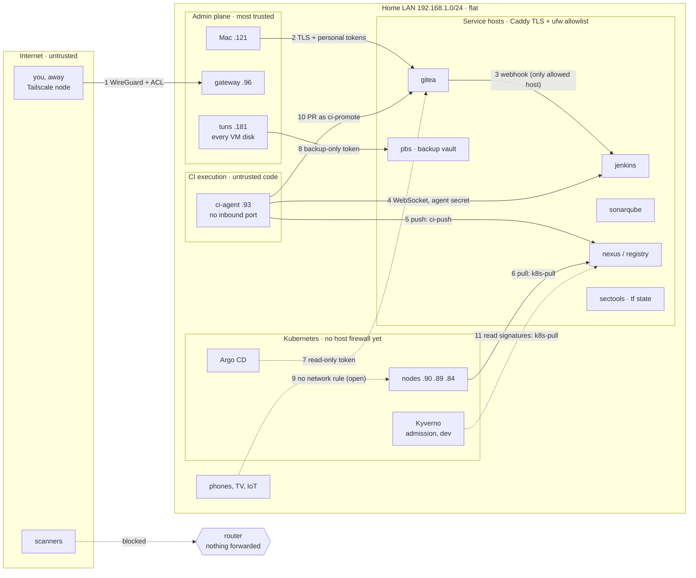

# Architecture (weeks 1–4)

The engineering view of the lab as built on 2026-10-31: where every component runs, which zones trust which,
how a commit becomes a signed image, and what is still open. Decisions behind it are in [`docs/adr/`](adr/);
every credential in detail is in [`credentials.md`](credentials.md); every way in is in [`entry-points.md`](entry-points.md).

- 18 VMs on one Proxmox host (13 running), 11 of them owned by Terraform
- 6 security gates on every build, 0 ports published to the internet
- Only signed, digest-pinned images from Nexus are admitted to the app namespace (`dev`); written to [the docs standard](standards/architecture-docs.md)

## 1. Topology

One physical host, **tuns** (Proxmox VE 9.1, 40 threads, 62 GB RAM, two mirrored 4 TB disks), runs every VM on one
flat home network, `192.168.1.0/24`. Services bind `127.0.0.1` and are reached through Caddy on `:443` with a
per-host internal CA. Names come from `*.home.arpa` on the gateway (ADR 0004).

| Host | VMID · IP | Role | Built by | Reachable on |
|---|---|---|---|---|
| tuns | — · .181 | Proxmox hypervisor; root of trust for every VM disk | hand | 22 (key only), 8006 (TOTP) |
| gateway | 121 · .96 | Tailscale subnet router; dnsmasq for `home.arpa` | Terraform + Ansible | 22, 53 |
| gitea | 122 · .97 | Source of truth for every repo; webhooks to Jenkins only | Terraform + Ansible | 443 (allowlist) |
| sectools | 120 · .95 | SeaweedFS S3 for Terraform state (Object Lock 30 days) | Terraform + Ansible | 443 (admins) |
| pbs | 123 · .98 | Proxmox Backup Server, 500 GB, nightly 01:30 | Terraform + Ansible | 8007 (tuns, admins) |
| nexus | 124 · .87 | Nexus CE; registry `registry.home.arpa`, immutable tags | Terraform + Ansible | 443 (admins, agent, k8s nodes) |
| sonarqube | 125 · .86 | SonarQube Community Build + local PostgreSQL 16 | Terraform + Ansible | 443 (admins, jenkins, agent) |
| jenkins | 126 · .88 | Jenkins LTS controller, JCasC, 0 executors | Terraform + Ansible | 443 (admins, agent, gitea, sonarqube) |
| ci-agent | 127 · .93 | Build agent: Docker, Trivy, Syft, Cosign, Gitleaks; gates in `/opt/ci-gates` | Terraform + Ansible | 22 only (dials out) |
| Master | 108 · .90 | Kubernetes 1.33 control plane (kubeadm, etcd) | imported into Terraform | 6443, 10250 (whole LAN) |
| WorkerNode1/2 | 107, 102 · .89, .84 | Argo CD, Kyverno, monitoring, NGINX Gateway Fabric v2.8.0, BelleShop | imported into Terraform | 10250, MetalLB .240–.243 |
| Tomcat, DockerApp | 103, 111 · .85, .92 | Legacy app hosts | hand + Ansible | app ports (DockerApp allowlisted) |

Parked: LocalAI 100 (off), UbuntuNew 101 (incident evidence, delete after 2026-11-25), old CI 104–106
(off, delete after 2026-11-28), templates 109, 110, 130.

## 2. Trust boundaries

Zones are drawn by how much we trust what runs inside them. Numbers are boundary crossings, listed below.

| # | Crossing | Authenticated by | Limited to |
|---|---|---|---|
| 1 | You (away) → gateway → LAN | Tailscale identity, WireGuard | Tailnet ACL: lab IPs only; arrives SNATed as `.96` |
| 2 | Mac → service hosts | TLS (per-host Caddy CA) + personal tokens | ufw allowlist on `:443`; laptop Gitea token is `write:repository` only |
| 3 | Gitea → Jenkins (webhook) | TLS (Jenkins CA trusted by Gitea) | `jenkins.home.arpa` is the only allowed webhook host (`ALLOWED_HOST_LIST`) |
| 4 | ci-agent → Jenkins | Agent secret read from a file, never argv | Outbound WebSocket on 443; the controller holds no SSH key to anything |
| 5 | ci-agent → Nexus (push) | `ci-push` via a Jenkins credential, password on stdin | Repo `belleshop` only; a tag can never be overwritten |
| 6 | k8s nodes → Nexus (pull) | `k8s-pull` imagePullSecret; containerd trusts the Nexus CA | Read only: a push is refused with 403 |
| 7 | Argo CD → Gitea | Read-only Gitea token in a Kubernetes Secret | Cannot write: nothing pushes into the cluster. Reads `belleshop-deploy` for the app since Week 4 |
| 8 | tuns → PBS | `pve@pbs!tuns` API token | Datastore.Backup: add backups, never delete them |
| 9 | Any home device → k8s nodes | none at the network layer | **Open**: Kubernetes RBAC and TLS only; host firewall in Week 6 |
| 10 | ci-agent → Gitea (promotion PR) | `ci-promote` token (Jenkins credential), on stdin to curl | Collaborator on `belleshop-deploy` only; `main` is protected and only the owner merges |
| 11 | Kyverno → Nexus | `k8s-pull` copy in `kyverno/nexus-pull`; Nexus CA in the chart values | Read only; used to resolve digests and fetch Cosign bundles |

The two pressure points are the CI agent, which runs code from pull requests (its Docker group is root on that VM,
which is why it is a VM of its own), and the cluster, whose API and kubelets any home device can reach today.

## 3. CI/CD pipeline

Every BelleShop push or pull request triggers one Jenkins multibranch job (ADR 0011). Jenkins only orchestrates; the
agent runs each gate as a script from [`ci/gates/`](../ci/gates/), installed to `/opt/ci-gates`. A failing gate stops the
build: no stage ends in `|| true`.

```mermaid
flowchart LR
  trig[Gitea push or PR<br/>webhook] --> jk[Jenkins<br/>PR-n or main]
  jk --> co[Checkout<br/>tag = short SHA]
  co --> sec[[Secrets<br/>Gitleaks]]
  sec --> test[[Tests<br/>pytest]]
  test --> sast[[SAST<br/>SonarQube gate]]
  sast --> deps[[Deps + misconfig<br/>Trivy fs]]
  deps --> build[Build<br/>bases by digest]
  build --> img[[Image<br/>Trivy image]]
  img --> sbom[SBOM<br/>Syft, SPDX]
  sbom -->|PR| stop([PR ends: nothing published])
  sbom -->|main only| push[Push<br/>Nexus, ci-push]
  push --> dig[Digest of our repo<br/>not RepoDigests 0]
  dig --> sign[Sign + attest SBOM<br/>Cosign, no tlog]
  sign --> promo[Promote<br/>PR in belleshop-deploy<br/>as ci-promote]
  promo --> arch[(reports, SBOMs,<br/>digests.txt archived)]
```

Double-bordered stages are gates.

### What the non-gate stages do

| Stage | What happens | Why it is there |
|---|---|---|
| Checkout, tag = short SHA | `IMAGE_TAG` = `git rev-parse --short=12 HEAD`. Every image, SonarQube analysis and report for the build carries it. | One commit maps to one image name, so you can trace a running pod back to its source. Never `:latest`, which points at something different each time. Nexus is `allow_once`, so a tag can't be pushed twice or rewritten. The tag is still only a label: the image's real identity is its digest (see *Digest*). |
| Build, bases by digest | `FROM python:3.12-slim@sha256:aa94…`. When a reference has both a tag and a digest, Docker uses the digest and the tag is only a comment for people. | A tag like `3.12-slim` is moved upstream every week. A digest is a hash of the exact bytes, so the build gets the same base until someone changes it in a reviewed PR. That also blocks a hijacked or re-pushed upstream tag. The cost is no free base-image updates; bumping is a deliberate PR. |
| Image, Trivy image *(gate)* | Scans the built image: OS packages from the base (dpkg, apk) plus language packages inside it. It runs twice, first to write a full JSON report and then to enforce HIGH/CRITICAL that have a fix. | Trivy fs only sees what the repo declares. The image also holds everything the base image brought, which no repo file mentions: curl and brotli in nginx, CVEs vendored inside pip. It runs before the push, so a failing image never reaches Nexus. |
| SBOM, Syft, SPDX | Syft lists every package in that same image (name, version, licence, purl) as SPDX JSON, the ISO/IEC 5962 standard format. | Not a gate; it's the evidence that goes with the image. On `main` it is signed and attached to the image digest (`cosign attest`). When a new CVE is announced, you can check which images contain the package by reading the SBOMs, without rebuilding anything. PRs generate it too, but only `main` publishes it. |
| Digest | After the push, read the `sha256:` that Nexus stored for *our* repo. Docker's `RepoDigests[0]` can be another registry's digest. | Signatures, attestations and the promotion PR all point at the digest, never at the tag. |
| Promote | On `main`: opens a PR in `belleshop-deploy` that pins both digests (`kustomize edit set image`), as the `ci-promote` bot. Skips when nothing changed. | CI never writes what Argo CD deploys. The owner's merge is the release; reverting the PR is the rollback. |

| Gate | Tool (pinned) | Fails the build when | Caught for real |
|---|---|---|---|
| Secrets | Gitleaks 8.30.1 | Any finding in git history (allowlist only in a reviewed repo file) | — |
| SAST | SonarQube 26.10, scanner 12.3 | Quality gate not passed; the scanner waits for it (`sonar.qualitygate.wait`) | — |
| Deps + misconfig | Trivy 0.76.1 fs | HIGH/CRITICAL vulnerability with a fix, or HIGH/CRITICAL Dockerfile/k8s misconfiguration | 4 k8s misconfigs (BelleShop PR-1) |
| Image | Trivy 0.76.1 image | HIGH/CRITICAL with a fix, OS or language packages | CVEs vendored in pip; curl, brotli (PR-1); 92 in an old base image (PR-3, blocked) |
| Exceptions | `.trivyignore.yaml` | An entry without `statement` or with an expiry more than 90 days out | none needed yet |

Rules around the pipeline:

- A branch that has a PR is built once, as `PR-n`. Two builds of one commit raced into the one SonarQube project
  (Community Build keeps a single history per project) and one was rejected.
- Fork PRs are not discovered at all.
- Every merge, in BelleShop and in `belleshop-deploy`, waits for the owner.
- Deploy is a separate loop (ADR 0012): merge the promotion PR → Argo CD syncs `belleshop-deploy` → Pod Security and
  Kyverno check every pod at admission → the backend rolls out as a canary with a success-rate analysis.

Proof of Week 3: [`evidence/week-03-image-gate-blocked.png`](evidence/week-03-image-gate-blocked.png).
Proof of Week 4: [`evidence/week-04-admission.txt`](evidence/week-04-admission.txt).

## 4. Supply chain

| Link | What makes it trustworthy | State |
|---|---|---|
| 1. Source | Private repos in Gitea; changes through gated PRs; secrets scan over history | in place |
| 2. Build | Isolated agent VM; base images pinned by digest; pip and curl removed from runtime images | in place |
| 3. Artifact | Nexus registry; a tag never changes; push and pull users separated | in place |
| 4. Signature | Cosign signature on the digest; SBOM as a signed attestation; verified with `cosign.pub` | in place |
| 5. Promotion | A bot PR in the config repo pins the digest; only the owner merges | in place |
| 6. Admission | Kyverno (Deny): signed by our key with a signed SBOM, from Nexus, by digest, no `:latest`, limits set; Pod Security `restricted` | in place |

Third-party images (mysql) come through the Nexus `dockerhub` proxy (`registry.home.arpa/library/…`) and are pinned by
digest, but not re-signed by us. The signing key is on the Jenkins controller (encrypted, password stored separately)
until the Week 5 secrets manager.

## 5. Identities and secrets (summary)

No values appear here or in git. Secrets are generated on the host that uses them, or created by the owner and moved
by Ansible with logging off; they travel on stdin or in files, never as command-line arguments. Full list:
[`credentials.md`](credentials.md).

| Credential | Can do | Lives in |
|---|---|---|
| `terraform@pve!homelab` | VMs in pool `terraform`, clone 2 templates | Mac `.envrc` (0600) |
| S3 key for `tfstate` | Read/write state; cannot delete versions (Object Lock) | Mac `~/.aws/credentials` |
| Gitea laptop token | `write:repository` | Mac `.envrc` |
| Gitea `argocd-readonly` | Read repositories | k8s Secret in `argocd` |
| Gitea `jenkins` token | Repo read/write (status, hooks), user read | Mac `private/` → Jenkins credential |
| `pve@pbs!tuns` | Add backups, never delete | tuns storage config |
| Nexus `ci-push` / `k8s-pull` | Push+read `belleshop` / read `belleshop` + `dockerhub` | nexus host → Jenkins credential / Secrets `dev/nexus-pull`, `kyverno/nexus-pull` |
| Gitea `ci-promote` token | `write:repository`; collaborator on `belleshop-deploy` only | Mac `private/` → Jenkins credential `gitea-ci-promote` |
| SonarQube `jenkins` token | Browse and scan `belleshop` only | sonarqube host → Jenkins credential |
| Cosign key + password | Sign images and attestations | Mac `private/` → Jenkins credentials |
| Jenkins agent secret | Connect as `ci-agent` | agent `/etc/jenkins-agent/secret` (0600) |
| Service admin passwords | Admin of Nexus, SonarQube, Jenkins | `/root` on each host (0600) |
| Caddy root CAs | Issue TLS for one host's names | key stays on the host; public cert in `ansible/files/ca/` |

## 6. Gaps and what closes them

| Gap | Why it matters | Closes with |
|---|---|---|
| Cluster reachable from any home device | API, etcd and kubelets have no network allowlist | Week 6: Proxmox firewall per VM |
| Secrets moved by hand or by Ansible | No rotation, no audit; signing key on the controller; `belleshop-secrets` was in git | Week 5: secrets manager, External Secrets |
| One CA per service host | Each client trusts several roots | Week 6: one lab CA, cert-manager |
| One copy of backups, on the same disks | A double disk failure loses the lab and the vault | Deferred: PBS stage 2 (off-host copy) |
| ingress-nginx retired upstream | No fixes after March 2026; v1.15.1 is the last release | Closed 2026-10-31: NGINX Gateway Fabric v2.8.0 (ADR 0013) |
| Python dependencies unpinned | Two builds of one commit can differ | A lock file with hashes |
| Promote stage inline in the Jenkinsfile | Runs only on `main`, so its bugs showed up only there | `ci/gates/promote.sh` with tests, in progress |
| Trivy DB from ghcr.io | A download failure fails a build | Trivy DB through Nexus, in progress |
| nginx:alpine has no fixed brotli-libs yet | The image upgrades one package itself | Bump the base when upstream moves |

Closed in Week 4: signatures enforced at admission, promotion write-back, Kubernetes 1.31 out of support,
mysql from Docker Hub by tag. Test tools in the backend image: BelleShop PR #8.
